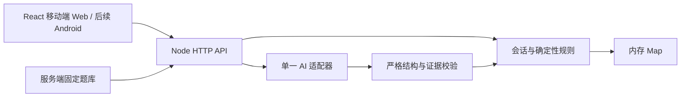
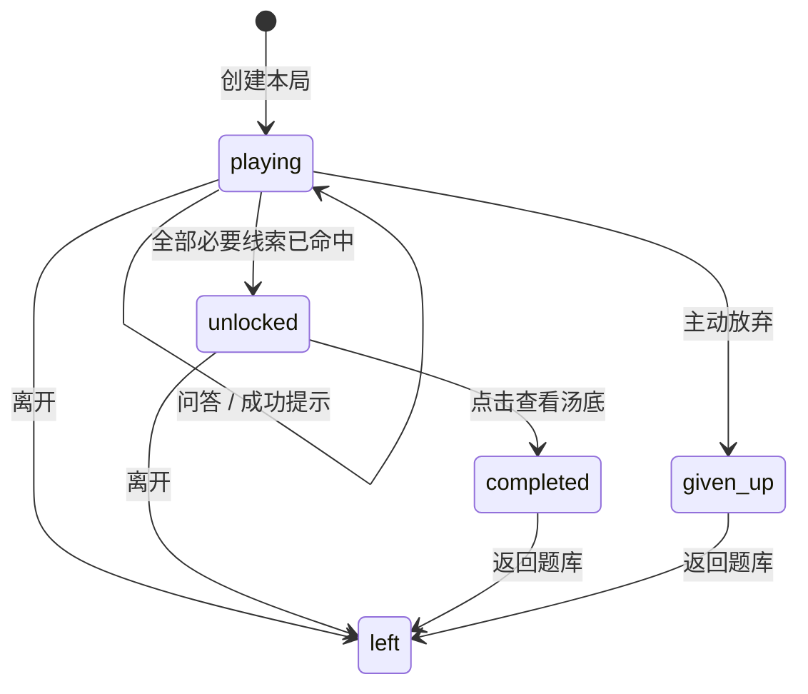

# AI 海龟汤最小架构

日期：2026-10-20。状态：实施契约，尚未证明真实模型质量或 Android 可用性。

依据：项目 `AGENTS.md`、V1.1 开发路径与执行上下文。实施范围固定为 Android、联网、文字、单人、约五题、题库/游戏/汤底三页，无账号和历史恢复。

## 1. 决策

采用一个 npm workspace：React + TypeScript + Vite 客户端，一个 Node + TypeScript HTTP 后端，一个纯类型共享包，服务端静态题库和内存会话。后续 Capacitor 包装同一套 Web 产物。无需数据库、RAG、向量库、账号、状态管理框架或独立演示工程。

客户端只负责展示、输入、发送动作和本局内存状态。后端拥有题目汤底、全部线索定义、模型调用、已发现线索、提示次数、状态、并发控制与解锁逻辑。AI 只能建议问答判定和有证据的线索候选，不能决定通关状态。

本轮不调用真实 AI、不读取或使用私密凭证。缺少配置时，服务器和页面必须明确显示不可用，不能自动改用模拟判题。测试替身只通过测试中的依赖注入启用。

## 2. 目录与依赖边界

| 路径 | 职责与依赖 |
|---|---|
| `packages/shared/src/contracts.ts` | HTTP 与内容的 TypeScript 契约；纯类型或无副作用常量，不导入题库、Node 或服务端模块 |
| `server/src/app.ts` | 创建 HTTP 应用，便于测试注入 AI 适配器；不在导入时监听端口 |
| `server/src/index.ts` | 读取运行配置、启动服务、关闭与会话清理 |
| `server/src/content.ts` | 从服务端内容目录读取题库、严格校验并生成公开投影 |
| `server/src/game.ts` | 会话状态、去重、提示上限、解锁和公开视图 |
| `server/src/ai/` | 真实适配器、结构校验与版本化问答/提示词 |
| `web/src/` | 三页界面、API 客户端和本局内存状态；不导入 `server` 或 `content` |
| `content/puzzles/` | 隐藏题库 JSON；不能置于 `web/public` 或被 Web 构建导入 |
| `eval/` | 人工标注用例、真实模型运行器与完整结果，和产品运行日志分开 |
| `tests/` | 确定性状态与 HTTP 边界测试；替身不代表真实 AI 效果 |
| `android/` | 环境检查后生成的同一客户端包装工程 |

推荐最少依赖：Web 使用 `react`、`react-dom`；后端使用 `express`、`zod`；工具使用 `typescript`、`vite`、`@vitejs/plugin-react`、`tsx`、对应 `@types` 和 `vitest`。根启动脚本需要并行进程时可加 `concurrently`。模型适配器直接使用 Node 原生 `fetch`、`AbortController`，暂不增加供应商 SDK。三页通过单个 React 页面状态切换即可，不必引入路由库。

依赖具体版本由总控根据本机可运行环境写入并提交 lockfile；本决策不冒充已安装或已验证。运行时须支持原生 fetch、crypto 与 AbortController。开发时 Vite 代理 `/api` 到后端；部署优先同源。Android 使用明确配置的可达 API 地址，前端环境变量只包含公开地址，不能包含模型密钥。跨源确有需要时使用明确来源允许列表。

首轮 UI 只呈现一题，保持三页：题库页选题、游戏页问答、结束后的汤底页。使用暖白背景 `#F4F1EB`、深色正文 `#1C2522` 和深绿操作色 `#215C4A`，错误状态使用清晰文字与 `#9E3D31`；系统中文字体，正文至少 16px、约 1.6 行高。游戏页顶部是可折叠汤面和进度，中部聊天及已发现线索区，底部固定输入并照顾安全区与软键盘。等待时禁用问答/提示重复提交，保留放弃和离开。未配置 AI 的硬状态就地显示并禁用提问/提示，不制作假对话、图库、营销页或额外题目卡片。

## 3. 题目与证据

每题内容版本在会话创建时固定；运行中的题目对象不能被原地修改。所有线索均为必要线索，每条只包含一个事实或一个明确方向的因果关系。因果线索引用事实 ID，但程序不会由这些事实自动推导命中。

内容维护完整汤底、原子语义、发现后文案、正负样例和提示方向。客户端题库只能得到公开题目信息及必要线索数量；游戏中只返回已发现线索的审核文案；完整汤底只在 `completed` 或 `given_up` 状态出现。

一次真实问答调用同时返回判定和线索候选。模型输入包含固定题目、可信历史和当前玩家消息，玩家文本明确作为不可信数据处理。程序使用固定主持人文案，避免模型自由回答额外泄露。候选必须引用当前玩家消息，以及必要时的已有玩家消息；引用片段必须是对应原文的连续子串。主持人或提示文本不能充当玩家证据。

程序能验证结构、ID 和原文来源，不能证明语义正确。标准表达、同义表达、否定、模糊近似及反向因果仍必须经过真实模型评测；没有凭证时这项门槛保持未通过。

## 4. 状态与提交

`unlocked` 只开放查看入口，点击查看才为 `completed`。解锁后停止问答和提示。放弃直接成为 `given_up` 并返回汤底。退出返回题库或开始新局时立即清空客户端旧局内存；临时切后台不主动退出。

每个会话最多一条问答或提示在处理。模型执行期间仅保留内部占用标记，不提交玩家消息、进度或提示次数。模型成功且通过校验后，以一个同步提交更新所有状态和 `revision`。失败保持领域状态完全不变，因此同一请求可以重试。

`give-up` 和 `leave` 可以在模型等待期间抢先提交，并取消该等待。每个异步结果提交前都要核对会话对象、状态、revision 和操作占用标记；旧结果不能覆盖已终结会话。客户端同时检查 session ID、页面代次和 revision，离开或新局立即增加代次并取消本地等待，避免迟到响应写入当前页面。

服务器未收到离开请求时，无法知道客户端已经退出；客户端丢弃 token 后旧局无法恢复，且旧局绝不能修改任何新局。服务器按空闲 TTL 清理残留会话。MVP 默认空闲 TTL 为 60 分钟，在进程中定期清理；进程重启清空所有对局，页面收到失效状态后返回题库。

完整幂等、错误码、字段和动作条件见 `CONTRACTS.md`。

## 5. AI 与提示

首版只设一个通用模型适配器，问答和提示分别调用。根据主控已完成的官方资料核对，首个候选为 DeepSeek：`AI_BASE_URL=https://api.deepseek.com`、`AI_MODEL=deepseek-flash`，使用兼容接口与 `response_format: {type:'json_object'}`，提示词明确要求 JSON。后端配置名固定为 `AI_BASE_URL`、`AI_MODEL`、`AI_API_KEY`，全部可更换且只存在后端。候选设置不是本工程的真实调用或质量验证；不绑定供应商 SDK。空内容、非法 JSON 或字段结构非法一律失败，不用文本截取或猜测补齐结果。

问答提示词版本为 `qa-v1`，提示提示词版本为 `hint-v1`，版本随评测记录保存。调用超时初值 30 秒；超时、网络失败、服务错误、非法 JSON、非法结构及证据非法均不提交。超时值是实施默认值，不是已经达到的性能目标。

提示只针对未发现线索，使用未使用过的提示方向；模型返回的文本仅作为 hint 消息。成功提交才加一次提示；达到三次时在模型调用前拒绝。提示本身不发现线索，随后玩家明确提问命中时可正常计入。提示方向和文本质量需真实人工评测，程序校验不能保证没有剧透。

## 6. 最小正确性与运行约束

- 每局随机 session ID 与高熵 bearer token；token 只放客户端内存，不写 URL、localStorage、日志或题库。所有局内读取与动作都校验 token。
- 所有请求做严格字段、长度与数值校验；玩家输入最多 500 个 Unicode 字符，空白不调用模型。玩家文本不得直接成为模板指令。
- session 响应使用 `Cache-Control: no-store`。健康接口只报告服务进程及 AI 是否已配置，不能将配置齐全宣称为模型已可用。
- 访问日志只记录方法、路径、状态、耗时及安全的关联 ID；不记录 bearer、密钥或普通玩家对话全文。受控评测另写指定数据集的完整记录。
- 匿名 API 设置进程内基本速率及并发限制；具体阈值由服务端实现记录，达到限额返回 429，不触发模型、不改变对局。
- 服务重启、TTL 失效、网络错误和 AI 未配置都必须有内联明确状态；不能只通过 modal 表达失败。

## 7. 文件所有权与依赖顺序

共享区必须只有一个写入者；下列是建议分配，由总控在台账落实。任何代理不得回退他人修改。

| 所有者 | 可写范围 | 依赖 |
|---|---|---|
| 总控 / 共享骨架执行者 | 根 `package.json`、lockfile、根配置、`packages/shared/`、台账 | 本文和接口契约 |
| 架构决策代理 | `docs/ARCHITECTURE.md`、`docs/CONTRACTS.md` | 已完成读取约束 |
| 内容执行者 | `content/puzzles/`、`eval/cases/` 及内容说明 | 先冻结 PuzzleDefinition 与模型输出字段 |
| 服务端执行者 | `server/` 和服务端测试目录 | 共享类型与首题配置；可先注入测试替身验证状态 |
| 客户端执行者 | `web/` 和客户端测试目录 | 共享 HTTP 契约；未配 AI 时实现硬状态 |
| 环境 / 安卓执行者 | 环境报告；经总控分配后的 `android/` 与 Capacitor 配置 | 不改根共享文件，Android 可与首题并行探测 |
| 评测执行者 | `eval/` 中运行器及 `tests/` 中独立验收测试 | 不修改内容代理正在写的 `eval/cases/` |

先落共享类型、首题和状态测试，再连接真实 AI；真实首题门槛通过后再认定迁移和客户端闭环成立。无凭证时仍可完成工程构建、公开投影检查、确定性状态测试和不可用界面，但台账必须保留真实语义验收未完成。
