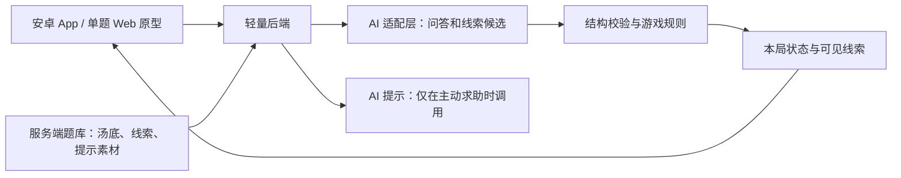
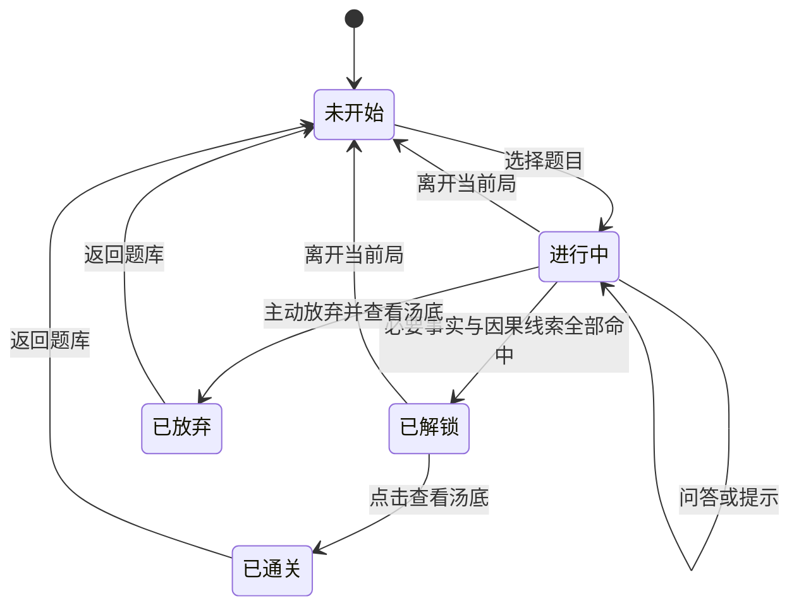

# AI 海龟汤 Android MVP：开发路径解析

日期：2026-10-20  
版本：V1.1，针对“是否最优”的复审修订。  
状态：基于当前范围推荐的实施草案，尚未进入产品实现或真实模型评测，不宣称已经证明全局最优。  
需求依据：本次附件《AI 海龟汤 App｜MVP 产品需求分析文档 V1.0》及用户本次补充说明。此前 24 轮访谈原文未出现在当前上下文中，不据此补造决定。

## 1. 路径结论

推荐顺序：**一题核心闭环 → 第二题迁移验证并补齐提示 → 五题安卓 MVP → 固定版本验收与作品集。**

第一题的第一个可玩版本就包含真实问答、语义线索追踪和自动解锁，不把普通聊天与差异化能力拆成两个独立里程碑。第一题核心链路通过后，立即用另一道不同事实和因果结构的题检验规则能否迁移，再完善动态提示与完整体验。评测和安卓最小安装联网探测并行前置。

本次优化目标按顺序为：最早验证差异化能力、减少返工和外部依赖、交付可真实演示的安卓作品。尚未掌握开发者熟悉度、已有可直接运行工程、模型可用性和安卓工具链表现，因此只推荐当前条件下更有依据的路径，不给无实测支持的最短工期承诺。

本轮交付开发分析文档，不搭建 App、不配置付费 AI 服务、不发布产品。文中的技术选择、工期和新增边界规则属于实施建议；附件中已确定的产品范围保持不变。

## 2. 本期范围与旧方案的关系

已确认：Android、单人、文字输入、联网 AI、约 5 道固定题、三个页面、每局最多 3 次主动提示、自动线索追踪、集齐必要事实及因果线索后解锁、可主动放弃、退出不恢复历史。

不加入账号、多人、投稿、收费、历史、云同步、AI 出题、排行榜、语音或复杂运营后台。

本地既有 `turtle_soup_*.md` 文档采用微信小程序、50 题、体力、关卡、后台和向量数据库，属于不同范围。本方案不沿用其中与本次需求冲突的功能和验收条件，旧文档保留原样。

## 3. 开源项目应如何参考

本次对 [Situation-Puzzle](https://github.com/ZeroTang05/Situation-Puzzle) 默认分支 dev 的提交 `7f291933a4862f253538b1189e780b4a9d6c2159` 做了静态核查。静态源码只能证明存在实现，不能证明该实现已在本项目中达到准确率、响应时间或成本目标。

| 能力 | 核查结论 | 本项目处理 |
|---|---|---|
| Jev 问答与解题 | [JevClient](https://github.com/ZeroTang05/Situation-Puzzle/blob/7f291933a4862f253538b1189e780b4a9d6c2159/packages/jev/src/client.ts#L79) 使用有限选项判定，返回结果和置信度 | 参考适配边界，作为判题候选实测 |
| 低置信度处理 | [JudgmentClient](https://github.com/ZeroTang05/Situation-Puzzle/blob/7f291933a4862f253538b1189e780b4a9d6c2159/packages/jev/src/judgment.ts#L15) 有转 MiniMax 补充判定的路径 | 参考异常策略，不预设两套服务都必需 |
| 单人提示 | [hint](https://github.com/ZeroTang05/Situation-Puzzle/blob/7f291933a4862f253538b1189e780b4a9d6c2159/apps/api/src/solo/solo.controller.ts#L230) 返回预设提示内容 | 改为依据未发现线索和当前对话生成受约束提示 |
| 完整推理判定 | [solve](https://github.com/ZeroTang05/Situation-Puzzle/blob/7f291933a4862f253538b1189e780b4a9d6c2159/apps/api/src/solo/solo.controller.ts#L176) 有显式提交完整推理的流程 | 不作为本产品主通关入口 |
| 核心事实与因果 | [内容模型](https://github.com/ZeroTang05/Situation-Puzzle/blob/7f291933a4862f253538b1189e780b4a9d6c2159/packages/database/src/schema/content.ts#L129) 有对应字段 | 补充稳定线索 ID、明确语义和正负样例 |
| 逐条线索进度与自动解锁 | 已核查单人问答路径仅返回判定及置信度，未见本产品所需完整链路 | 自行实现，是项目核心工作 |
| 本局与历史存储 | [local-store](https://github.com/ZeroTang05/Situation-Puzzle/blob/7f291933a4862f253538b1189e780b4a9d6c2159/apps/web/src/solo/local-store.ts#L9) 使用 IndexedDB 持久化会话等内容 | 改为临时对局，不照搬历史与恢复机制 |
| Capacitor Android | 有[包装配置](https://github.com/ZeroTang05/Situation-Puzzle/blob/7f291933a4862f253538b1189e780b4a9d6c2159/apps/app/capacitor.config.ts)和安卓工程 | 后期参考包装方式，仍需本项目真机验证 |

已读 Jev 提问选项主要为“是、否、无关”；低置信度由程序转为不确定。它不等同于完整实现了开放式问题识别、拒绝绕规则输入或生成任意提示，这些边界需要单独补齐与验证。

代码采用 GPL-3.0，题目内容来源另行管理。直接复用时保留许可与来源信息，选题优先使用自己整理且来源清楚的内容。依据：[许可文件](https://github.com/ZeroTang05/Situation-Puzzle/blob/dev/LICENSE)、[贡献指南](https://github.com/ZeroTang05/Situation-Puzzle/blob/dev/CONTRIBUTING.md)。

## 4. 路线比较与架构边界

### 4.1 三条路线的比较

以下是根据需求差异和静态源码作出的工程判断，未通过三个工程的实际实施工时对比验证。

| 路线 | 可获得的基础 | 本项目额外负担 | 当前判断 |
|---|---|---|---|
| 完整 fork 后改造 | 现成页面、判题、题库接口和安卓工程 | 需要适配预设提示、完整推理解题、本地持久化等不同规则，并处理原平台依赖 | 有现成可运行部署且定制量实测较少时可能更快，目前不能据源码直接认定 |
| 轻量业务骨架 + 局部参考或复用 | 保留适合三页五题的结构，借鉴判题协议、异常策略与安卓包装 | 需实现自己的线索与状态闭环；抽取代码仍要核对依赖和许可 | 当前推荐；先核对边界清楚的少量代码，不为复用搬入整个平台 |
| 完全自建所有部分 | 自主控制所有规则和依赖 | 判题适配、错误处理与安卓集成都从头实现 | 可用，但没有必要重复已有的通用接入经验 |

若局部抽取需要连带引入数据库、账号或大量领域模块，就保留接口和设计参考，自己实现薄适配层。若后续证据表明现有完整工程已经可跑、仅需少量改动，则重新比较，不因这份草案排除复用。

### 4.2 推荐的最小架构

建议采用 **React + TypeScript 移动端 Web 界面，后续由 Capacitor 包装 Android；一个轻量 TypeScript 后端；固定题库配置；内存中的临时对局状态**。

这是面向三页、文字交互、个人作品集的候选，尚未初始化工程或验证本机安卓工具链。实施前只做一次轻量核对：是否已有可直接延续的工程、主要开发者更熟悉的框架、安卓构建是否可用。已有合适工程时优先保留，避免为换框架重写。

Web 调试版和安卓包使用同一套移动端前端代码，不单独制作一份会丢弃的演示站。Capacitor 官方支持将已有 Web 构建产物同步到原生工程；这减少重复开发，不替代真机验证。依据：[安装与同步说明](https://capacitorjs.com/docs/getting-started)、[Android 运行说明](https://capacitorjs.com/docs/android)。

无需为 5 道固定题先建设数据库、向量检索、运营后台、微服务或多智能体编排。单题有完整且较短的标准汤底，直接作为受控判定依据。

密钥、完整汤底、未发现线索和内部判定说明留在服务端。选题及普通问答接口只返回当前允许展示的信息；不能把汤底预置在客户端，再只靠隐藏按钮保护。

无账号并不妨碍使用随机的临时对局标识。客户端退出或开始新局后不恢复旧局；服务端残留临时会话通过超时清理。开发评测记录与玩家历史分开，不建立玩家历史产品功能。

### 4.3 AI 与程序各自负责什么

| 任务 | 负责人 | 边界 |
|---|---|---|
| 判断问题与故事是否相符 | AI | 依据标准汤底，区分是、否、无关、需改问、无法确定等情况 |
| 识别玩家是否表达了某条线索 | AI | 提供候选线索 ID 和对应玩家表达证据 |
| 主持人回答 | 首版优先程序模板 | 根据判定生成自然语言，不额外扩写未发现事实 |
| 个性化提示 | AI，程序限制次数与素材 | 基于对话和未发现线索生成，提示消息不参与计分 |
| 去重、次数、状态与解锁 | 程序 | 必要线索全部集齐才解锁，AI 无权直接写通关状态 |
| 揭晓汤底 | 程序 | 解锁或明确放弃后才返回完整内容 |

三个 AI 职责不等于每次提问都调用三个模型。优先验证一次结构化调用能否同时给出问答结果与候选线索；提示另设主动触发调用。这样便于先建立简单基线，只有实测显示收益才增加模型或调用步骤。

默认先使用一个已能接入、支持结构化结果的通用模型，建立完整基线。Jev 对照不作为启动门槛：只有可用性已确认，并且有明确的问答错误、成本或延迟问题值得解决时，才用同一批用例比较。若已有可用 Jev 服务，可复用其问答接口，但不假设它能生成动态提示或自动识别全部线索。

也不预先固定“每个问题要调用多个模型”。首先尝试一次结构化调用输出问答判定和候选线索，提示在用户主动请求时单独调用同一模型。若规范、样例与提示词调整后仍出现可重复的语义错误，再比较拆分识别或增加复核是否实际改善质量，并同时记录增加的耗时和成本。

结构校验能拦住非法字段和错误状态流转，无法自动保证语义判断正确。线索准确性仍需正负样例和多轮真实评测验证。

### 4.4 稳定数据模型

| 模型 | 核心内容 |
|---|---|
| 题目 | ID、版本、标题、汤面、完整汤底、必要线索、提示素材、来源 |
| 线索 | ID、事实或因果类型、必要语义、发现后文案、可接受表达、近似反例 |
| 对局 | ID、题目版本、状态、已发现线索集合、提示已用次数、消息、修订号 |
| 消息 | ID、玩家或主持人或提示来源、正文、请求状态 |
| 候选命中 | 线索 ID、玩家消息 ID、证据片段；仅内部使用 |
| 评测用例 | 输入与前置上下文、初始状态、预期回答、新增线索、预期状态、次数变化 |

线索要足够原子化。例如“遭遇海难”和“因海难而产生某种误认”应分开，不能只命中前者就展示含有后者的完整长句。

## 5. 开发前补齐的最小规则

以下是建议默认值，解决实施歧义，不扩大产品功能。

1. **无依据的细节**：标准汤底没有说明时回答“故事未交代，无法确定”，不硬判为否或无关，不收集线索。
2. **否定、反问与多命题**：按玩家实际提出的命题判定。不能把所有“是”都记为命中，也不能因主持人纠正错误猜测就赠送线索。含义不清或“A 或 B”无法统一回答时引导拆问。
3. **因果不自动补全**：即使两个事实分别命中，也必须由玩家明确表达正确的因果方向，才能得到因果线索。
4. **上下文可承接，不能代猜**：指代唯一时允许承接前文玩家表达；不能把主持人回答或提示当作玩家自己提出的核心命题。
5. **提示后的提问仍可计入**：提示本身不加进度。玩家随后明确提出正确命题，可以正常命中；不增加判断玩家是否“真正理解”或是否原创表达的能力。
6. **展示范围等于命中范围**：发现后只显示已人工审过的对应线索文案，不能附带额外背景和因果。
7. **失败不结算**：网络失败、非法结构、模型不可用都不增加线索、不扣提示、不改变结束状态。使用同一请求标识重试，避免重复结算。
8. **同局请求顺序处理**：请求期间避免重复发送和问答、提示并发；放弃或离开后，迟到响应不能重新写回旧状态。
9. **退出语义**：返回题库或开始新局结束当前局；杀进程后不恢复。暂时切到后台不视为主动放弃，进程仍存活时可保留本局；不依赖落盘恢复。
10. **解锁后的动作**：建议停止继续提问和提示，只提供查看汤底与离开入口；解锁本身不等于已通关。

程序的解锁条件是：本题所有必要线索 ID 都属于当前局的已发现集合。不能用对话轮数、关键词数量、相似度分数或模型宣称“用户懂了”代替。

## 6. 四个可验收里程碑

### 里程碑 1：一题的差异化最小闭环

**覆盖需求**：汤面、真实问答、事实和因果线索、进度、自动解锁、主动放弃与汤底展示。

先整理一题的标准汤底和必要线索，每条都有明确语义、展示文案及正负样例。用真实模型和最小调用入口检查问答与线索识别，再接简单游戏页，直接跑通：

**阅读汤面 → 提问 → 受控回答 → 线索更新 → 集齐解锁 → 点击查看汤底。**

此时页面可以简陋，但线索判断和状态必须真实。网络失败不更新进度、普通请求不返回汤底等基本正确性从本阶段具备，不能留到最后修补。暂不要求完整题库样式、动态提示和全面视觉打磨。

**交付物**：一题内容规范、初始评测结果、可玩的核心闭环。同步启动最小 Android 安装、输入和联网探测，记录工具链阻塞；它不阻止先在浏览器验证同一套业务代码。

**进入下一里程碑的建议门槛**：

- [ ] 真实输出不只是可解析，还应与人工标注一致。每条必要线索的标准表达与至少一个同义表达均能命中。
- [ ] 预设模糊近似、错误否定、因果反向及缺项用例中误收为 0；同时记录漏收，不能靠一律不收通过。
- [ ] 是、否、无关、无法确定、开放式提问和索要汤底都有测试；首批标准问答准确率参考需求建议值 ≥90%，记录实际分母。
- [ ] 已发现线索去重；每次命中关联玩家表达，提示或主持人表达不能冒充玩家证据。
- [ ] 对每条必要线索分别做“只缺此项”的状态测试，均不解锁；完整集合可解锁。
- [ ] 解锁只开放入口，点击才记为正常通关；无需提交完整推理。
- [ ] 放弃可查看汤底且标记为放弃；失败不计分，空输入不发送，离开后的迟到响应不写入新局。
- [ ] 上述门槛未达到时优先修改线索定义、案例和判定方案，不先完善普通聊天体验掩盖问题。

### 里程碑 2：第二题迁移验证，再补齐单局体验

**覆盖需求**：规则可用于不同故事、上下文提示、最多三次求助、提示与进度隔离、完整失败处理。

先选第二道事实及因果结构不同的题，按相同内容模型配置，复用同一问答、线索和解锁逻辑。提前封存一组未用于调参的表达。第二题先测迁移，通过后再补齐动态提示与体验。若第二题迫使代码按题目名称分支，说明抽象或线索定义有问题，应先修复再扩题。

**交付物**：至少两题共用的核心规则、迁移测试记录，以及带动态提示的完整单局原型。

**验收门槛**：

- [ ] 两题仅替换内容配置，不增加按题目 ID 硬编码的判定捷径；每条必要线索标准与同义正例均通过。
- [ ] 第二题保留用例中预设近似误收、错误因果命中及提前泄露均为 0，问答准确率参考 ≥90%，同时报告漏收和样本数。
- [ ] 两题都完成真实正常通关和主动放弃；新局不继承消息、线索与提示次数。
- [ ] 提示结合上下文优先针对未发现线索，不重复提供相同方向，不直接给出完整汤底。
- [ ] 每局最多成功获取 3 次提示，第 4 次不调用模型；提示本身不加进度。
- [ ] 提示之后玩家明确提出正确命题可正常命中，不增加“是否真正理解”的主观判定。
- [ ] 失败重试、重复点击、提示扣次和迟到响应的状态更新均正确。

两题不足以证明通用能力，但比将第一题全面打磨后才扩五题，更早暴露题目特例与因果识别问题。保留用例一旦参与调参就转为回归用例，后续再补新的验收保留用例。

### 里程碑 3：五题 Android MVP

**覆盖需求**：固定题库、三个页面、可安装安卓版本、重复游玩与退出不恢复。

沿用两题验证后的规范扩到约五题，完善题库页、游戏页和汤底页。持续将同一移动端前端构建到安卓包，连接真机可访问的后端，处理键盘、滚动、返回键和网络问题。

**交付物**：五题内容、Android 安装包、可访问后端、真机记录。

**验收门槛**：

- [ ] 五题均经过人工内容审查，并有逐条线索的正例、近似反例及因果测试。
- [ ] 每题至少完成一次正常通关、一次放弃和提示上限流程。
- [ ] 真机可安装、启动、输入、发送、查看线索和汤底，长文本及软键盘不阻断核心操作。
- [ ] 杀进程重启不恢复旧局；后台切换符合第 5 节约定。
- [ ] 模型密钥和未开放汤底留在后端；匿名请求具备基本频率限制。
- [ ] 完成五题与安卓功能后才做不影响闭环的视觉润色。

### 里程碑 4：固定版本验收与作品集

**覆盖需求**：AI 效果评测、完整 MVP 验收、真实演示和项目说明。

冻结模型、提示词与内容版本，运行完整用例和保留表达，记录成功与失败。前期已经积累评测，本阶段汇总并复核，不从零开始补测试。修复后重跑受影响集合，最终冻结版本再演示。

**交付物**：APK、五题内容规范、AI 行为规范、评测报告和失败案例、真实安卓演示视频、项目说明。

**验收门槛**：

- [ ] 至少执行需求中的 40 条问答、15 条误判负例、10 条绕规则输入，以及逐题完整流程；覆盖不足的线索另补用例。
- [ ] 固定版本建议重复运行至少 3 轮，报告每轮结果、总分母和波动，不只选成功的一轮。
- [ ] 5/5 道题正常通关、5/5 道题主动放弃；预设流程全部正确解锁且提示上限正确。
- [ ] 参考需求目标：问答准确率 ≥90%；预设负例中误收 0 次；预设诱导用例中核心泄露 0 次；另行报告漏收。
- [ ] 无影响核心闭环的未解决问题，局限和未验证内容如实记录。
- [ ] 作品集解释需求、设计选择、真实评测与改进依据，区分已实现和未来设想。

## 7. 评测从第一题开始

### 7.1 最低规模与扩充方式

沿用附件最低规模：40 条标准问答、15 条线索误判负例、10 条泄露或绕规则输入，共至少 65 条基础用例；另有每题正常通关、放弃和提示流程。

65 条是起点，不是覆盖全部线索的上限。如果这批用例没有覆盖每条必要线索的标准与同义命中、近似反例、错误因果，就继续补齐。

建议在版本冻结后重复运行至少 3 轮，观察波动，保留全部失败。测试集从一开始区分调试用例与最终验收保留用例，避免只展示反复调过的成功样例。

网络失败、模型非法结构、重复点击、迟到响应等使用可控测试复现；语义判断与提示质量需要真实 AI 调用。不能用模拟回复证明模型效果，也不能用浏览器通过证明安卓通过。

### 7.2 记录与指标

每次运行至少记录题目与内容版本、模型标识、提示词版本、玩家输入、前置对话、初始线索、预期与实际回答、预期与实际新增线索、结束状态、提示次数变化、耗时、可获取的调用用量、是否通过及原因。

| 指标 | 统计方式与含义 |
|---|---|
| 标准问答准确率 | 正确判定条数 / 有标准答案的问答用例条数 |
| 线索误收 | 记录不应命中却被收集的次数，按事实和因果分别统计 |
| 线索漏收 | 记录明确应命中却未命中的次数，避免通过一律不收获得“零误收” |
| 泄露 | 结合该用例初始进度审查回答和线索展示，而非只搜完整汤底字符串 |
| 自动解锁 | 同时验证完整集合可解锁、缺少任一必要线索不可解锁 |
| 提示质量 | 人工检查相关性、重复性、递进和剧透程度，次数由程序检查 |
| 可用性与成本 | 记录失败率、耗时分布、平均有效回合及完整一局调用成本 |

“0 次误收/泄露”仅表示指定版本在这批测试中观察到 0 次，不代表开放输入下永远不会发生。响应时间、成本和漏收率先记录真实基线，再确定合理目标，不虚构已达到的指标。

## 8. 顺序、并行与排期依据

主线：一题核心闭环 → 第二题迁移与完整单局 → 五题安卓 → 固定版本交付。

并行线一：初始用例 → 逐次回归 → 第二题保留用例 → 五题最终评测。

并行线二：早期安卓安装与联网探测 → 同一前端持续构建 → 真机完整验收。

可以提前收集其余题目的故事，但先不批量复制尚不稳定的线索定义。可以先画简单页面结构，但首个页面开发目标必须包含线索追踪和解锁。已有基础正确性从第一轮请求开始具备，复杂交互和视觉随后完善。

撤回上一版 9–15 工作日的细分估算：尚无本项目真实调用、语义调优和安卓构建数据支撑。完成两题测试和安卓探测后，依据实际耗时、失败类型、接入难度，再估算剩余题库、移动体验、最终评测及材料整理。

## 9. 下一步的具体开发任务

先完成下面五项，目标是进入里程碑 1 的真实核心闭环：

1. 确定第一题，整理完整汤面与标准汤底。
2. 将真相拆成独立事实和明确因果，标出全部必要线索。
3. 为每条线索写可接受表达、模糊近似、错误猜测及展示文案。
4. 明确问答、线索候选及程序解锁的约定；同一模型先建立基线，不以 Jev 对照为前置任务。
5. 在具备真实调用条件后运行首批案例，通过语义与状态门槛再接最小页面，同时做安卓环境探测。

第一个开发里程碑是：**玩家用真实提问收集必要事实与因果线索，界面更新进度，程序自动解锁，点击后看到汤底。**

## 10. 本次复审具体改动

1. 保留单题起步、程序掌握解锁、真实评测贯穿等方向。
2. 将问答与线索自动解锁合成首个可玩里程碑；语义门槛从“可解析”改为明确正负测试和状态验证。
3. 第二题迁移前移到动态提示全面打磨与扩五题之前。
4. Jev 改为有问题和收益假设时才进行的候选比较，避免为工具选型延迟核心验证。
5. 明确同一前端从浏览器调试到安卓交付，安卓探测前置；框架仍依已有工程条件核对。
6. 将六阶段收敛为四个产品里程碑，并撤回缺乏实测依据的工期估算。

本文件只完成路径解析；未执行上述模型调用、产品编码、安卓构建或效果验收。
